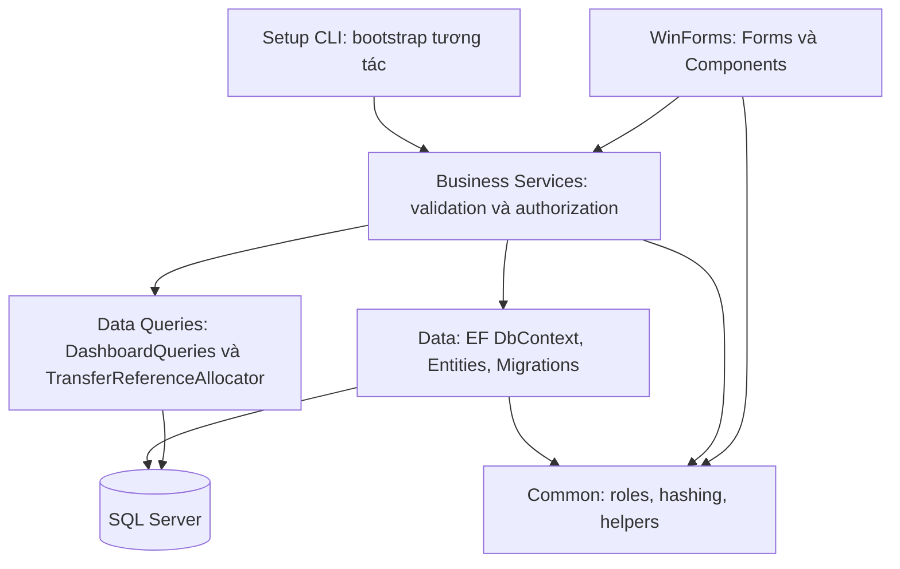
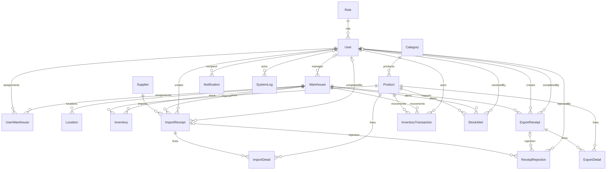

# Kiến trúc hiện hành — 14/10/2026

Mô tả code sau các quyết định TeamChot, không thay thế kết quả nghiệm thu. Schema quản lý bằng EF Core Migrations; SQL legacy giữ để tham khảo. Dự án có 19 entity sau khi bổ sung ReceiptRejection và ReceiptStatusChange, giữ nguyên ba file Configurations.

## Ranh giới các tầng



UI chỉ tham chiếu Data tại composition Program. Các form gọi UiServices để serialize việc dùng context; không chứa SQL hoặc tự tính lại công thức tồn. EF đảm nhiệm CRUD/LINQ; Data dùng ADO.NET parameterized cho daily movement và cấp transfer sequence trong transaction hiện hành. Repository/UnitOfWork không được tạo thêm chỉ để bọc EF.

## Quan hệ dữ liệu



ReceiptRejection phải tham chiếu đúng một phiếu nhập hoặc xuất (CHECK XOR); không sao chép detail. UserWarehouse có PK composite UserId/WarehouseId, IsActive và Restrict FKs. Inventory có unique ProductId/WarehouseId, không phân tồn bằng Location. Diagram thể hiện quan hệ logic; hành vi FK/delete/unique/CHECK cụ thể xem model và migrations.

## Luồng Complete và audit

```mermaid
sequenceDiagram
    participant UI as Form
    participant S as Import/ExportService
    participant I as InventoryService
    participant DB as SQL transaction
    participant E as Publisher/Notification
    UI->>S: Complete với trusted session
    S->>DB: Begin Serializable và reload phiếu
    S->>S: Validate actor/scope/status/details/idempotency
    S->>I: PostReceiptLine trong cùng context/transaction
    I->>DB: Thay stock, movement và quantity audit
    S->>DB: CompletedBy/At, alerts, SystemLog
    S->>DB: Save và Commit
    S->>E: InventoryChanged/StockAlert/ReceiptCompleted
    E->>DB: Notification best-effort sau commit
    S-->>UI: Thành công; refresh không replay
```

Nếu ghi stock/audit/log lỗi trước commit, transaction rollback. SQL1205 được retry tối đa2lần khi SQL rollback chắc chắn; không retry timeout/mất kết nối/unknown commit. Subscriber hoặc notification lỗi sau commit không lặp stock.

Reject lưu RejectReason hiện hành và thêm ReceiptRejection trong cùng transaction; Resubmit về DRAFT rồi Submit lại, giữ history/RejectReason. Cancel cần CancelReason; phiếu có history không được hard-delete, có thể hủy theo quyền/trạng thái.

## Chuyển kho, điều chỉnh và analytics

- Transfer dùng ReferenceId chung cấp bởi SQL sequence; mỗi movement có TransactionId riêng và loại TRANSFER_OUT/IN. Unique filtered index trên ReferenceId/TransactionType; cả hai phía commit atomically. Mã OUT/IN/MOV/TRF hiển thị từ các ID hiện có, không thêm TransferReceipt.
- QuantityAudit lưu Before/After/SignedDifference; giá trị cũ chưa biết giữ NULL. SignedDifference=After−Before, quantity movement vẫn dương. Không backfill audit bằng suy đoán.
- Giá trị tồn ước tính dùng Quantity×PurchasePrice hiện tại, ghi rõ không phải giá vốn kế toán. Bình quân gia quyền giai đoạn sau chưa triển khai.
- ABC theo detail xuất COMPLETED, 12tháng đến hết hôm nay; A/B threshold cấu hình; dòng vượt ngưỡng vẫn nằm trong nhóm đang tích lũy. Luân chuyển xét 90ngày gồm hôm nay, first movement là mốc theo dõi. Đề xuất nhập chỉ gợi ý theo MaximumStock−Quantity khi Quantity<=ReorderPoint.
- SQL integration tests là opt-in trên target TEST được phê duyệt; native UI tests và export QA là bước riêng, không suy từ unit tests rằng giao diện đã hoàn thiện.

## Bổ sung lifecycle audit — 15/10/2026

ReceiptStatusChanges lưu mọi chuyển trạng thái thực tế với from/to/actor/time/reason, đúng một phiếu nhập hoặc xuất, FK Restrict. Bao gồm chuyển REJECTED→DRAFT qua UpdateDraft hoặc Resubmit; không tạo snapshot chi tiết hay tự purge. Latest SubmittedBy/At, ApprovedBy/At, CancelledBy/At và CompletedBy/At được cập nhật cùng transaction với history. Ngày/người tạo nháp dùng trường hiện có; legacy chưa biết vẫnNULL, không backfill bằng suy đoán. Draft chưa từng xử lý có thể xóa theo quyền; có rejection/status history thì không hard-delete. UI/PDF hiển thị latest audit; lịch sử xử lý20/trang cùng warehouse authorization. Giữ best-effort, không Outbox; WAC để giai đoạn2.